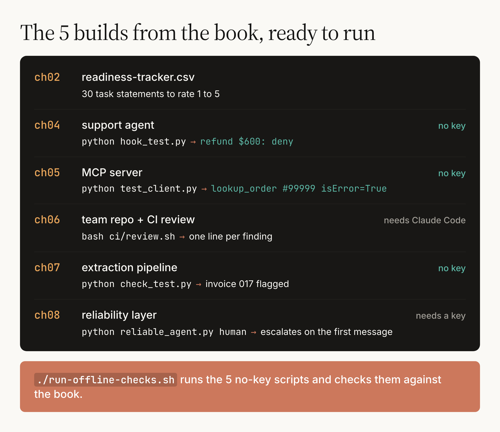

# CCAR-F exam guide: the 5 builds

[](https://github.com/regardo911/claude-certified-architect-ccar-f-exam-guide/actions/workflows/ci.yml) [](LICENSE)

**The support agent, the MCP server, the team repo with its CI review, the extraction pipeline and the reliability layer, running on your machine and checked against the book.**

Companion code to the book *Claude Certified Architect CCAR-F Exam Guide* from [youcanbuildthings.com](https://youcanbuildthings.com).

Every file Chapters 4 to 8 have you type, a folder per chapter, to diff your copy against. Two words first: a **hook** is code that runs before or after a tool call (Chapter 4), and an **MCP server** is a program that hands Claude a set of tools (Chapter 5). Pick your line below.

## Start here

**"I'm about to start Chapter 4."** Set up once, then prove the no-key scripts run before you spend anything:

```bash
python3.13 -m venv .venv && source .venv/bin/activate
pip install -r requirements.txt
./run-offline-checks.sh
```

It runs the five no-key scripts, compares what each prints with the book, and ends with `5 of 5 passed`. A `FAIL` line shows the diff.

**"I typed a chapter's files and one won't run."** Diff yours against the copy here, then check [CHANGELOG.md](CHANGELOG.md). Five files carry a small addition, marked `repo:` at the top; the rest match the book byte for byte.

```bash
diff ~/my-ccar/support_agent.py ch04/support_agent.py
```

Type the files yourself first; you'll learn more from your own typos.

**"I passed and want the builds for real work."** Copy what you need:

| From this repo | Into your project | Steps |
|---|---|---|
| `ch04/support_agent.py` | your agent's folder | [ch04](ch04/#on-your-own-agent) |
| `ch05/server.py` + `.mcp.json` | your project root | [ch05](ch05/#on-your-own-system) |
| everything in `ch06/` | the root of your team's repo | [ch06](ch06/#on-your-teams-code) |
| `ch07/schema.py` + `extract.py` | your pipeline | [ch07](ch07/#on-your-own-documents) |
| `ch08/reliable_agent.py` | next to your agent | [ch08](ch08/#moving-it-onto-your-agent) |

## Chapter map

| Folder | What you build | Command | Success looks like | Key? |
|---|---|---|---|---|
| [ch02](ch02/) | readiness tracker | open `readiness-tracker.csv` | 30 rows, each rated 1 to 5 | no |
| [ch04](ch04/) | agent loop, support agent, 3 hooks | `python hook_test.py` | `refund $600: deny` | no; `loop.py`, `support_agent.py`, `fork_test.py` yes |
| [ch05](ch05/) | MCP server | `python test_client.py` | `isError=True` with `"isRetryable": true` for order 99999 | no; `route_test.py` yes |
| [ch06](ch06/) | team repo + CI review | `bash ci/review.sh` | one line per finding, severity bug, security or validation | Claude Code |
| [ch07](ch07/) | extraction pipeline | `python check_test.py` | 017 flagged, 018 clean | no; `extract.py`, `batch.py` yes |
| [ch08](ch08/) | reliability layer | `python reliable_agent.py human` | `escalate_to_human` is the first tool call | yes |
| [ch10](ch10/) | mock score sheet | fill in `score-sheet.md` | every domain at its go line | no |



## What it needs

- Python 3.11 or later. The 3.9 that ships with macOS can't install the Agent SDK.
- The four pins in `requirements.txt`, the same as the book's install line.
- An Anthropic API key (`export ANTHROPIC_API_KEY=...`) for the live runs in Chapters 4, 5, 7 and 8, all on the smallest model.
- Claude Code for Chapter 6, and `jq` for `ci/review.sh`.

## Fixes and license

Found a file that doesn't run the way its chapter says? Open an issue; fixes land in [CHANGELOG.md](CHANGELOG.md) or [BOOK-FIXES.md](BOOK-FIXES.md). MIT licensed.

Educational code, provided as is, with no warranty. Not affiliated with or endorsed by Anthropic. The practice questions stay in the book.
