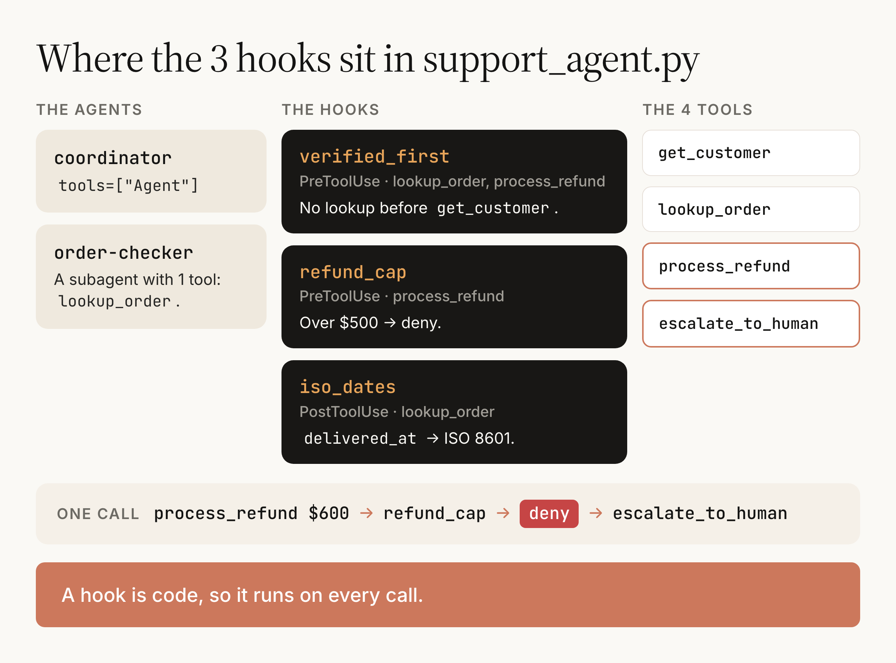

# Chapter 4: the agent loop and the support agent

A Messages API loop that stops on `stop_reason`, then a coordinator with one scoped subagent and three hooks.



Run from inside `ch04/`; the tests import their siblings.

```bash
cd ch04
python loop_test.py         # no key
python hook_test.py         # no key
python loop.py              # key
python support_agent.py     # key
python fork_test.py         # key
```

- `hook_test.py` prints `lookup before verify` denied and `refund $600: deny`.
- `support_agent.py` prints a `TOOL` line per call, then `DONE`, a `DENIED` list and the reply. Any `process_refund` over $500 lands in `DENIED`; whether the model tries one is its call.
- `fork_test.py` prints three session IDs: the fork's is new, the resume's matches base.

## On your own agent

`loop.py` and `support_agent.py` take a message as their first argument:

```bash
python support_agent.py "I'm ana@example.com. Order #12346 never came. Refund it."
```

To use a real backend, rewrite the four `@tool` functions and keep the three hooks. Change the `500` in `refund_cap` to your limit, and the same number in `hook_test.py`'s `for amount in` line.
