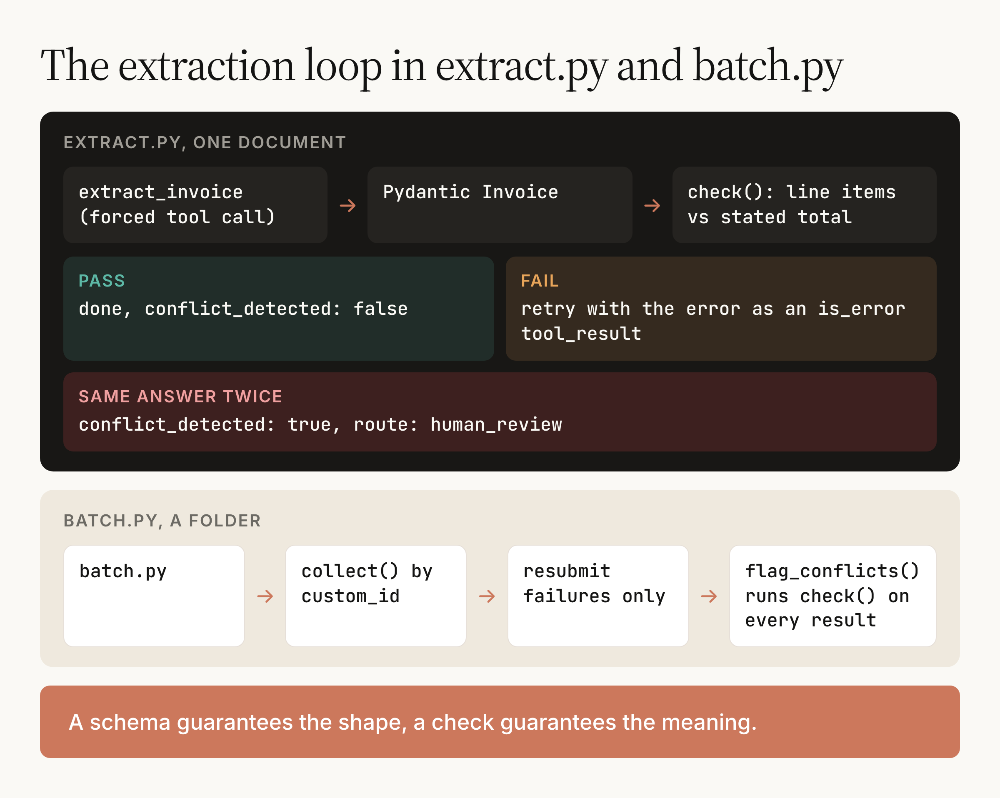

# Chapter 7: the extraction pipeline



```bash
cd ch07
python check_test.py                           # no key: 017 flagged, 018 clean
python make_invoices.py                        # no key: wrote 100 invoices
python extract.py                              # key: invoice-001.txt
python extract.py invoices/invoice-017.txt     # key
python batch.py                                # key
```

On 017, look for `"conflict_detected": true` and `"route": "human_review"`. `batch.py` polls every 60 seconds, can take up to 24 hours, writes `extracted.json`, and ends with the invoices whose totals don't add up. The book's check: exactly 017, 034, 051, 068 and 085.

## On your own documents

Rewrite `EXTRACT_INVOICE` in `schema.py` for your fields: all required, the ones a document may leave out wrapped in `nullable(...)`. Mirror it in the `Invoice` model, and change `check()` to test what your fields must agree on. Keep the retry and the same-answer-twice stop. Then `python extract.py your-doc.txt`, or `python batch.py your-folder`.
