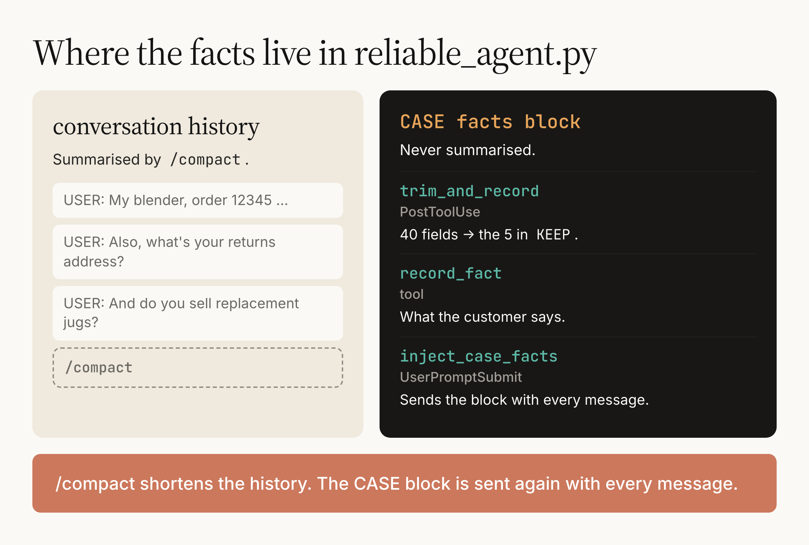

# Chapter 8: the reliability layer



All four need a key:

```bash
cd ch08
python reliable_agent.py human
python reliable_agent.py timeout
python reliable_agent.py compact
python reliable_agent.py compact --no-facts
```

The chapter's checkpoint:

- `human`: `escalate_to_human` is the first tool call, with no lookup before it.
- `timeout`: `lookup_order` tried twice for 12346, 12345's details in the answer, a gap named for 12346, and a `Coverage:` line.
- `compact`: two `record_fact` calls, and after `/compact` the answer still names order 12345, $600 and the Friday claim.
- `--no-facts`: the book's run stayed exact too. The block is for the 40-turn chat where a summary blurs.

## Moving it onto your agent

Try your own conversation by adding it to `SCRIPTS` and running it by name. To move the layer, copy `trim_and_record` with your own `KEEP` list, `inject_case_facts`, `record_fact` and the escalation section of `SYSTEM`, and register the hooks as `options` does.
